<div align="center">

# Reclaim

**See where your Plex server's disk space goes, decide what to let go, and get the space back.**

Reclaim lines up Plex's library and watch history against bytes on disk: what takes the space, when
anyone last played it, how many people watched it, and who asked for it. When you've decided, it
deletes through Plex and unmonitors the title in Radarr or Sonarr so it isn't downloaded again, or it
has Radarr or Sonarr swap in a smaller release. It runs on your own network, talks to your own
services, and has no accounts or telemetry.

[](https://github.com/chungus-actual/reclaim/actions/workflows/test.yml)


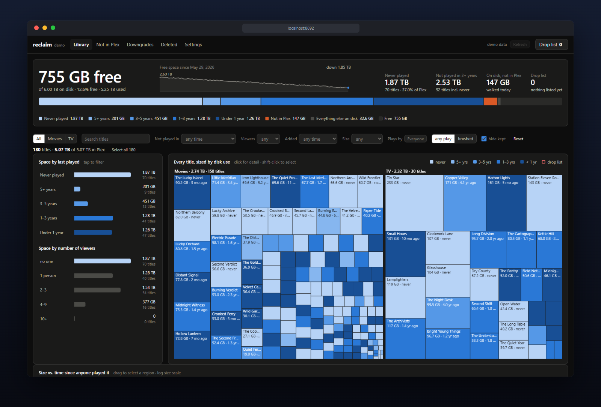

<sub>The made-up demo library: 150 movies and 30 shows on a nearly full 6 TB array.</sub>

</div>

---

## On the page

| | |
|:---:|:---:|
| 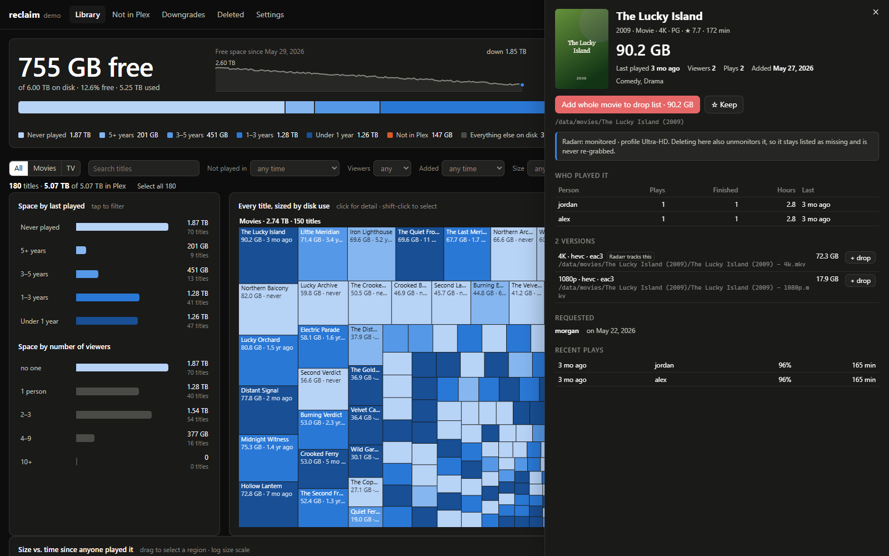<br><sub>A movie in detail: who played it and how much, each version and its files, what Radarr thinks of it, who requested it</sub> | 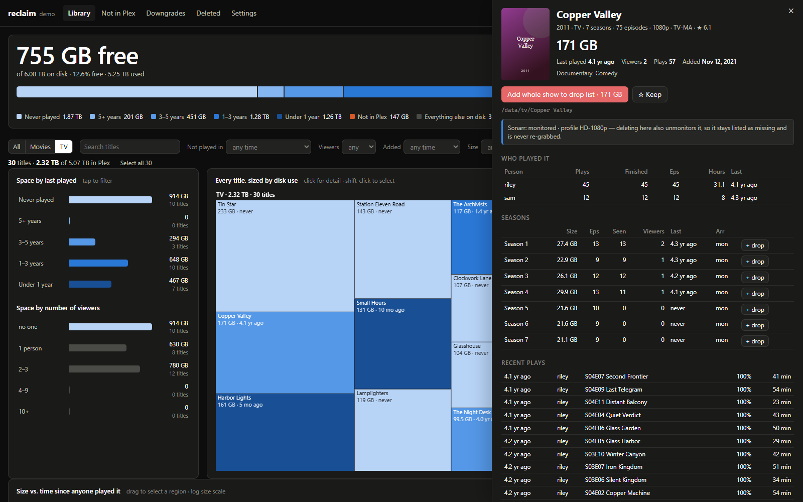<br><sub>A show in detail: every season with its size, episodes seen and viewers, and its own drop button</sub> |
| 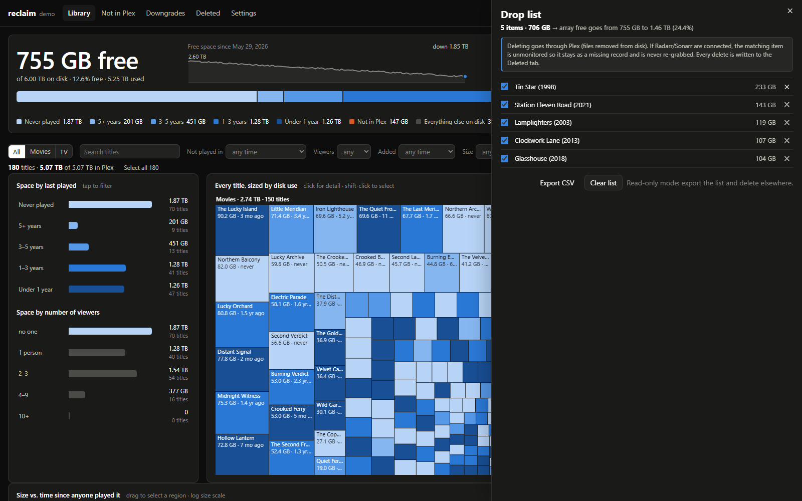<br><sub>The drop list: shortlist titles, seasons or single versions and see the free space add up before anything is deleted</sub> | 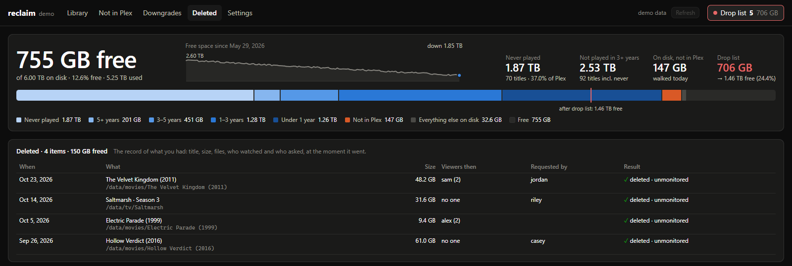<br><sub>The Deleted tab: title, size, files, who watched it and who asked for it, kept after the files are gone</sub> |
| 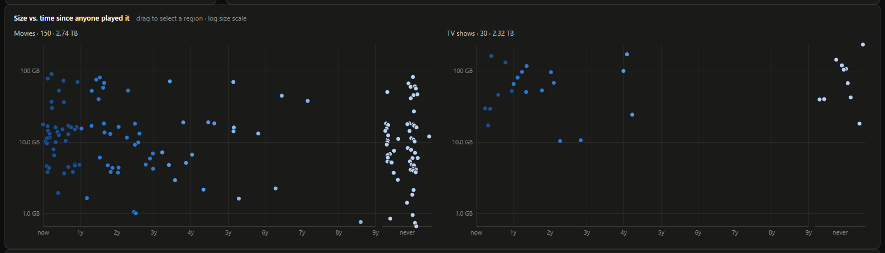<br><sub>Size against time since anyone played it. Big and forgotten sits top right; drag to select a region</sub> | 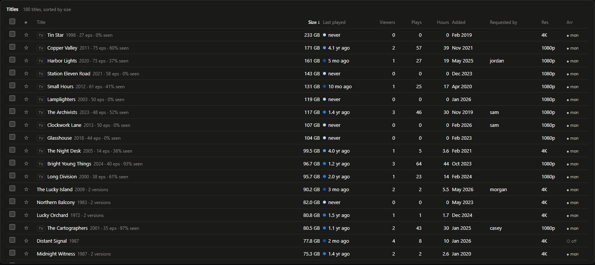<br><sub>The whole library as a table, sorted and filtered on size, last play, viewers, plays, requester, resolution and *arr status</sub> |
| 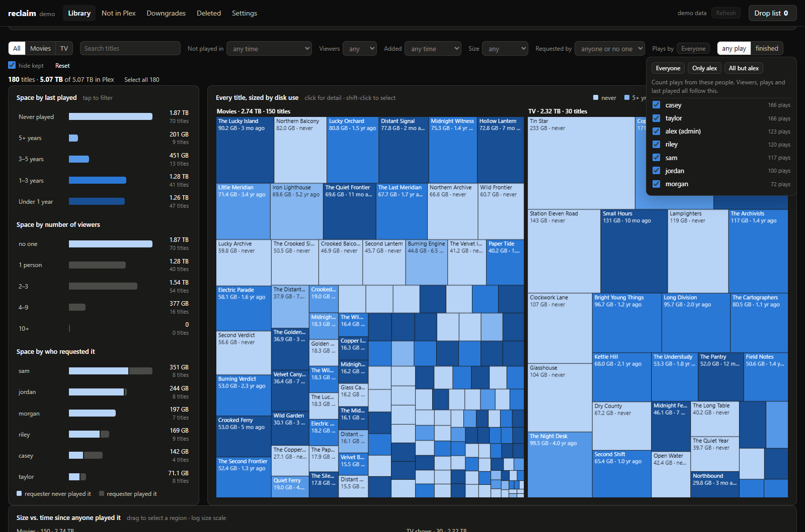<br><sub>Count plays from any set of people and every number follows. With Overseerr or Jellyseerr connected: space by requester, and how much of it they never played</sub> | 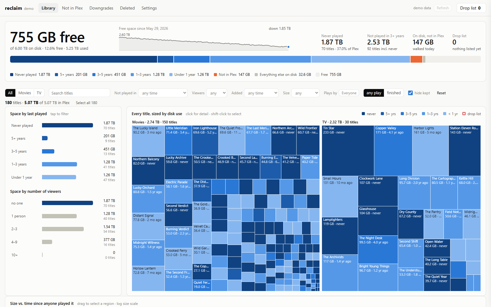<br><sub>Light or dark, following your system</sub> |
| 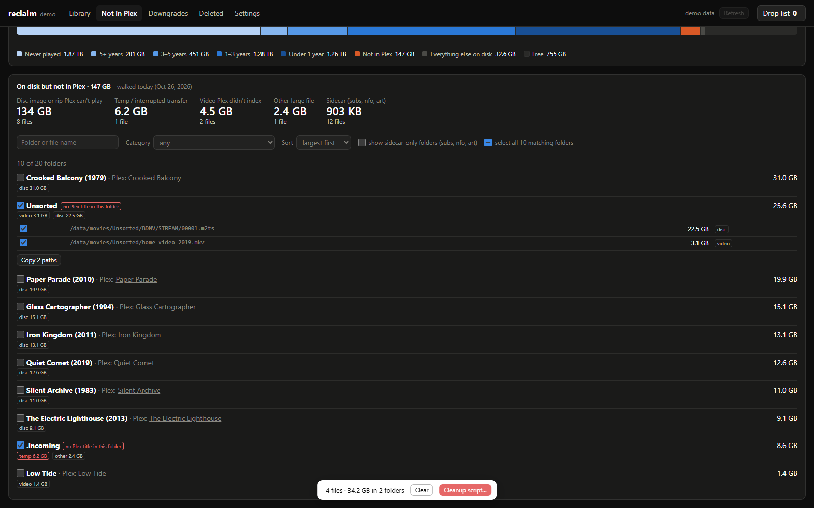<br><sub>Not in Plex: disc images, interrupted transfers, unmatched video and sidecars found by walking the disk</sub> | 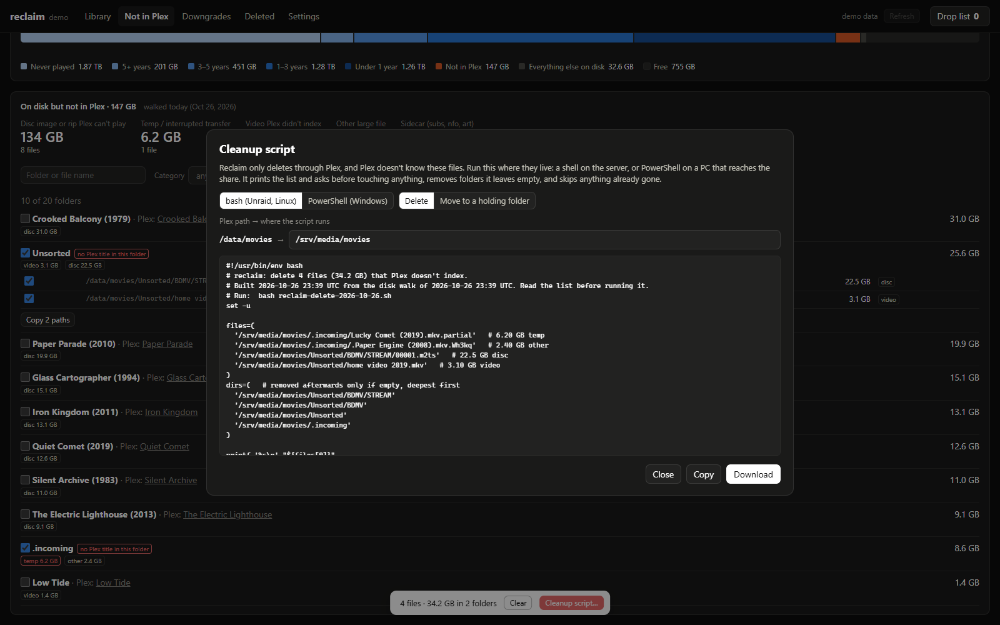<br><sub>Tick files or folders and get a bash or PowerShell script that deletes them or moves them aside</sub> |

<sub>Every screenshot is the made-up demo library from <code>tools/demo_data.py</code>. See <a href="#try-it-without-a-server">Try it without a server</a>.</sub>

## Contents

[On the page](#on-the-page) · [Features](#features) · [How it works](#how-it-works) ·
[Try it without a server](#try-it-without-a-server) · [Install](#install) · [Configure](#configure) ·
[Deleting](#deleting) · [Downgrades and replacements](#downgrades-and-replacements) ·
[Files Plex doesn't index](#files-plex-doesnt-index) · [Running without Docker](#running-without-docker) ·
[What leaves your network](#what-leaves-your-network) · [Troubleshooting](#troubleshooting) ·
[Limitations](#limitations) · [Development](#development) · [License](#license)

## Features

| | |
|---|---|
| **Where the space goes** | Free space with a chart of it over time, and the used space split by when anything was last played (never, 5+ years, 3 to 5, 1 to 3, under a year), files Plex doesn't index, and everything else on the disks. A marker shows the free space after your drop list |
| **Treemap and scatter** | Every title sized by disk use and shaded by time since anyone played it; size against years since the last play on a log scale, movies and TV side by side. Click for detail, shift-click or drag a region to select |
| **Breakdowns** | Space by last played, by number of viewers, and, with Overseerr or Jellyseerr, by who requested it and how much of that the requester never played. Click a bar to filter by it |
| **Table and filters** | Size, last played, viewers, plays, hours, added, requester, resolution and Radarr/Sonarr status. Sort on any column; filter by library, title, time since played, viewers, date added, size and requester |
| **People lens** | Count plays from everyone, only you, everyone but you, or any set of people, and any play or finished plays only. Every number on the page follows |
| **Title detail** | Who played it and how much, a season table for TV, versions for movies, Plex-indexed extras, files Plex skipped in the same folder, requests and recent plays |
| **Drop list** | Shortlist whole titles, single seasons or single versions, export it as CSV, and delete with a typed confirmation. A starred (kept) title never lands on it |
| **Deletes that leave a record** | Deletes through Plex, checks the item is gone, unmonitors exactly that item in Radarr or Sonarr, and writes title, size, files, viewers and requester to the Deleted tab |
| **Downgrades** | Swap a 4K or 1080p file for a 1080p or 720p release you pick from your own Radarr or Sonarr search. The *arr replaces the file on import, so the title is never missing |
| **Not in Plex** | Walks the disk and lists disc images and rips, interrupted transfers, unmatched video, other large files and sidecars Plex doesn't index. Search, filter by category, sort, page |
| **Cleanup scripts** | Tick files or folders Plex doesn't index and get a bash or PowerShell script that deletes them or moves them to a holding folder. It lists the files and asks before touching anything |
| **Replacements** | A movie folder Plex has no title for (usually a disc rip Radarr tracks) can be swapped for a playable 1080p or 720p release |
| **Set up in the browser** | Sign in with Plex, a card per service, and a Test button that checks the real service and says what's wrong. Environment variables override and lock any field |
| **Guard rails** | Read-only mode, an optional login, a typed `DELETE` before anything is removed, and API keys that never reach the browser |

## How it works

<picture>
  <source media="(prefers-color-scheme: dark)" srcset="docs/diagrams/sources-dark.svg">
  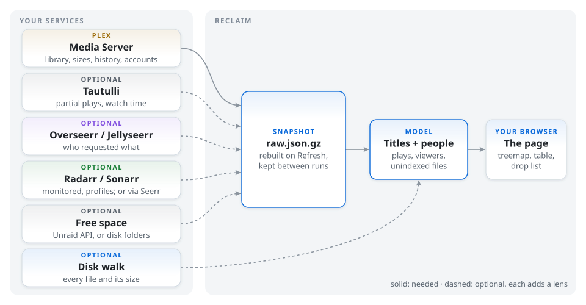
</picture>

Plex is the only source Reclaim needs; the dotted ones are optional, and one that fails is noted on
the page while the rest still builds. Sizes come from Plex's own index (a file's size there is its
size on disk), deduplicated by path so a multi-episode file counts once. The disk walk is joined to
that index by path, which is how files Plex doesn't know about are found. For titles whose folder
holds video or large files the index doesn't account for, Reclaim also asks Plex for their local
extras, so a `Featurettes` folder counts as in Plex.

Everything Reclaim fetched is kept as a snapshot, so the page loads from it at once and only
rebuilds when there's a reason to:

| When | Rebuild |
|---|---|
| Start | if there is no snapshot, or it is older than `RECLAIM_STALE_HOURS` (20) |
| Every night | at `RECLAIM_REFRESH_HOUR` (4) in the container's `TZ` |
| Refresh | the button at the top of the page |
| Settings saved | when a service or the disk walk changed |
| A downgrade imported | five minutes later, once Plex has scanned the new file |

With a disk walk set up, a walk follows each rebuild (`WALK_AFTER_REFRESH`), and **Walk now** on the
Not in Plex tab starts one by hand.

## Try it without a server

```sh
git clone https://github.com/chungus-actual/reclaim.git && cd reclaim
python3 -m venv .venv && .venv/bin/pip install -r backend/requirements.txt
.venv/bin/python tools/demo_data.py --data data-demo
cd backend && RECLAIM_DEMO=1 RECLAIM_DATA=../data-demo RECLAIM_HOST=127.0.0.1 ../.venv/bin/python main.py
```

Open `http://localhost:8892`. The demo is an invented library of 150 movies and 30 shows on a nearly
full 6 TB array, watched (or not) by seven invented people. It's read-only and contacts no service.
`demo_data.py` refuses a folder that already holds a `settings.json`, so it can't overwrite a real one.

## Install

| Need | |
|---|---|
| Plex Media Server | and the **server owner's** token: watch history and deletes need it |
| Docker | with Compose v2.24 or newer (the optional `.env` uses `required: false`), or Python 3.12 |
| Optional | Tautulli; Radarr v4+ and Sonarr v4+ (API v3); Overseerr or Jellyseerr; the Unraid 7 API |

```sh
git clone https://github.com/chungus-actual/reclaim.git && cd reclaim
docker compose up -d --build
```

| Step | How |
|---|---|
| 1. Open it | `http://<host>:8892`. The first visit opens **Settings** |
| 2. Connect Plex | **Sign in with Plex**, pick your server and an address for it (a local one is best), then **Save and build**. Or type the URL and paste the owner's `X-Plex-Token` |
| 3. Wait a minute | The first build of a large library takes about a minute. After that the page loads from the snapshot |
| 4. Allow deleting | In Plex: Settings > Library > Allow media deletion. The Plex test tells you if it's off; browsing works either way |
| 5. Add the rest | Tautulli, Radarr, Sonarr, Overseerr/Jellyseerr, free space and the disk walk each have a card: fill it in, press **Test**, save |

Tests talk to the real service and say exactly what's wrong: a wrong key, "That's Sonarr, not
Radarr", a Tautulli that watches a different Plex server, a folder mapping where Plex's files aren't
found. A test never changes anything on the other side.

**Docker Compose**

| Setting | Value |
|---|---|
| Port | `8892`, or `RECLAIM_PORT` in `.env` (the mapping and the app follow it) |
| `./config:/config` | settings, the database, the snapshot and poster thumbnails |
| Media (optional) | mount it **read-only** for the disk walk, e.g. `/path/to/Movies:/media/movies:ro`, then map it in Settings > Disk walk |
| `.env` (optional) | anything set there overrides the app; see `.env.example` |
| `TZ` | the timezone the nightly rebuild runs in |
| `user: "99:100"` | uncomment on Unraid, so files in `/config` belong to nobody:users |
| Health check | `GET /api/health`, which stays open when a login is on |

## Configure

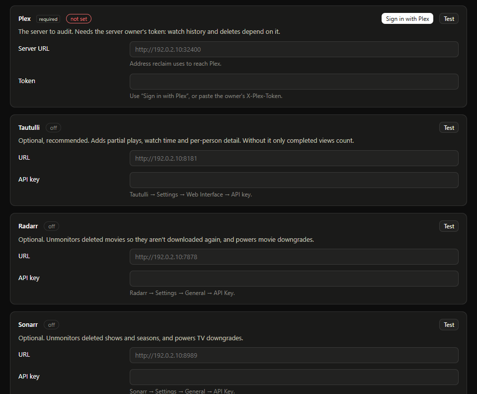

Everything is set in the **Settings** tab and saved to `settings.json` in the data folder (`/config`
in Docker), readable only by its owner. API keys and tokens never go back to the browser, only
whether they are set, and a login password set there is stored as a salted PBKDF2 hash.

Environment variables (or a `.env` file in the repo root, in `/config`, or at `RECLAIM_ENV_FILE`)
**override** the app and show as locked in Settings:

| Variable | Default | Needed for | Notes |
|---|---|---|---|
| `PLEX_URL`, `PLEX_TOKEN` | | everything | The owner's token. Without one, Reclaim only works from an IP in Plex's "allowed without auth" networks |
| `TAUTULLI_URL`, `TAUTULLI_API_KEY` | | richer history | Partial plays, watch time and per-person detail. Without Tautulli, Plex's own history is used, which only records finished views, so more titles look "never played" |
| `RADARR_URL`, `RADARR_API_KEY` | | unmonitor on delete, downgrades | One instance. Left blank, it's discovered from Overseerr or Jellyseerr (its non-4K default server) |
| `SONARR_URL`, `SONARR_API_KEY` | | unmonitor on delete, downgrades | The same, for TV |
| `SEERR_URL`, `SEERR_API_KEY` | | "who requested it" | Overseerr or Jellyseerr. `OVERSEERR_URL` and `OVERSEERR_API_KEY` also work |
| `UNRAID_URL`, `UNRAID_API_KEY` | | free space | Unraid 7 GraphQL, e.g. `http://tower/graphql`; the key needs read access to the array |
| `CAPACITY_PATHS` | | free space | Instead of Unraid: comma-separated folders inside the container on your media disks; each disk counts once |
| `WALK_PATHS` | | Not in Plex | `plex path=container path`, comma separated, e.g. `/data/movies=/media/movies` |
| `WALK_AFTER_REFRESH` | `1` | | Walk after every rebuild |
| `DISPLAY_PATHS` | | | How paths are shown and copied, e.g. `/data=/srv/media`. Also where bash cleanup scripts start |
| `RECLAIM_READ_ONLY` | `0` | | `1` turns off deletes, downgrades and replacements |
| `RECLAIM_USER`, `RECLAIM_PASSWORD` | | | HTTP basic auth on everything but `/api/health`. Put a TLS proxy in front if Reclaim is reachable from outside your LAN |
| `RECLAIM_REFRESH_HOUR`, `TZ` | `4`, `UTC` in Compose | | The nightly rebuild hour and its timezone |
| `RECLAIM_PORT` | `8892` | | The port Reclaim listens on. Environment only |
| `RECLAIM_HOST` | `0.0.0.0` | | The address it listens on; `127.0.0.1` keeps it to this machine. Environment only |
| `RECLAIM_STALE_HOURS` | `20` | | Rebuild at start when the snapshot is older than this. Environment only |
| `RECLAIM_DATA` | `/config` in Docker | | Where state lives (`data/` beside `backend/` outside Docker). Environment only |
| `RECLAIM_DEMO` | `0` | | `1` serves the demo library from `tools/demo_data.py`, read-only. Environment only |

**The data folder**

| File | Holds |
|---|---|
| `settings.json` | what you saved in Settings |
| `reclaim.db` | SQLite: the drop list, kept titles, the deletion record, downgrade jobs, and the free space at every rebuild and delete (the chart) |
| `raw.json.gz` | the last snapshot of every source |
| `walk.json.gz`, `extras.json.gz` | the last disk walk, and the Plex extras looked up for it |
| `thumbs/` | poster thumbnails fetched from Plex |

Every request that changes something carries an `X-Reclaim: 1` header. A browser can't send it from
another site without a preflight Reclaim never grants, so other pages can't post to it.

## Deleting

<picture>
  <source media="(prefers-color-scheme: dark)" srcset="docs/diagrams/delete-dark.svg">
  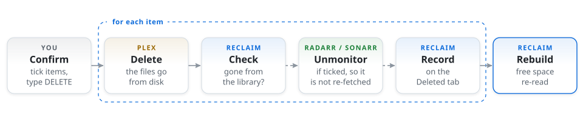
</picture>

Delete goes through Plex (`DELETE /library/metadata/<key>`), which removes the media files from
disk, and Reclaim then checks the item is really gone. Seasons and single movie versions can be
deleted on their own. Every attempt, failed or not, is written to the Deleted tab with its files, who
watched it and who requested it.

Radarr and Sonarr ship with "Unmonitor deleted movies/episodes" switched **off**, so a file that
disappears outside them leaves the title *missing and monitored*, and the next matching release on
RSS gets downloaded again. With Radarr and Sonarr connected, Reclaim unmonitors exactly the item you
deleted (not a global setting), so it stays in the *arr as a record and is never grabbed again. A
single version is the exception: the *arr is left alone, since the movie still has a file.

| What else happens | |
|---|---|
| Files Plex skipped | An ISO next to the MKV, subtitles: Plex leaves them behind. The detail drawer lists them, and Not in Plex can build a script for them |
| A running downgrade | One for the same title (or season) is cancelled, so its import can't put a file back |
| The disk walk | The deleted files are dropped from it, so they don't turn up as "not in Plex" |
| Free space | Re-read and the page rebuilt |

**There is no undo.** Nothing is deleted without typing `DELETE`, and `RECLAIM_READ_ONLY=1` turns
deleting off entirely; the drop list can then only be exported as CSV.

## Downgrades and replacements

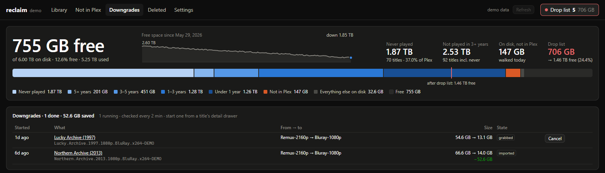

Radarr and Sonarr only ever upgrade. A quality's rank is its position in the profile's list, and
the import step only rejects a file that ranks *below* the one already there. So Reclaim keeps a
profile per target in each app, `Reclaim ↓1080p` and `Reclaim ↓720p`, built from the app's `Any`
profile with everything above the target (and remux and disc formats) moved to the very bottom, only
the target tier allowed, and upgrades switched off. It's created the first time you grab at that
tier.

<picture>
  <source media="(prefers-color-scheme: dark)" srcset="docs/diagrams/downgrade-dark.svg">
  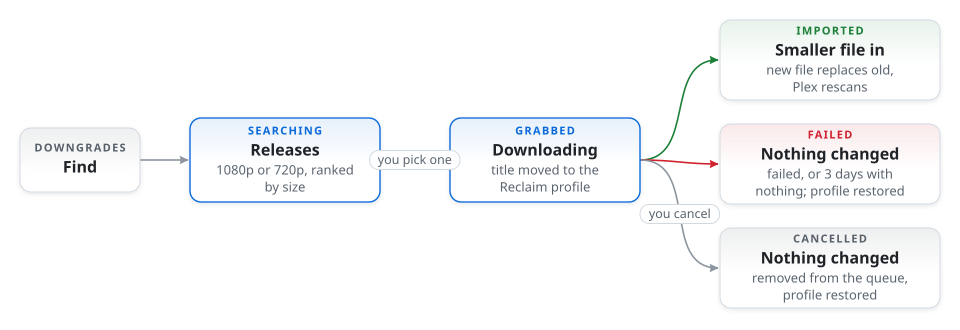
</picture>

When you pick a release, Reclaim grabs it through the *arr's normal release API. When the download
imports, the *arr treats it as an upgrade and replaces the old file, so the title is never missing.
Reclaim checks every two minutes, asks Plex to rescan that folder, and records the savings on the
Downgrades tab. With upgrades off, the *arr can't grab anything on its own while you wait, and can't
drift back up later. For a TV series the profile applies to the whole show, so new episodes also
arrive at the lower tier. A movie with two versions only has the file Radarr tracks swapped.

| The picker | |
|---|---|
| Shown | releases at the target resolution only, never remux, BR-DISK or Raw-HD; for TV, full season packs for that season |
| Blocked | anything the *arr rejects for a reason other than quality ranking, the current profile or size limits; names that look like extras, specials, samples or trailers; files too small to be the whole thing |
| Flagged | a low bitrate (under 6 MB a minute at 1080p, 4 at 720p), outside your *arr's size rule, AV1 (some Plex clients transcode it), several audio languages |
| Pre-selected | the *arr's own top-ranked usable release that saves at least 25% and isn't low on bitrate; multi-audio last unless the series is anime |
| Speed | as fast as your indexers: seconds for a movie, about two minutes per TV season |
| Freshness | grab within 25 minutes of the search; the *arr forgets results at 30 |

**Replacements.** A movie folder that Plex has no title for but Radarr knows (matched by folder
name, usually a disc rip Radarr tracks as the movie's file) gets **Find a replacement** on the Not in
Plex tab. It's the same search and grab at 1080p or 720p, without needing a saving. The Reclaim
profile ranks disc formats lowest, so the release imports over the ISO; Radarr deletes the file it
tracked, and Plex rescans the folder so the movie shows up. If Radarr tracks no file there, the new
one lands beside the old files, which a cleanup script can then remove.

Downgrades and replacements are hidden in read-only mode.

## Files Plex doesn't index

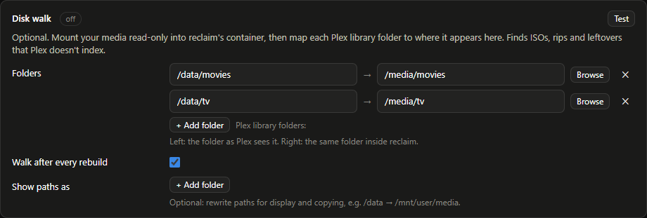

Mount your media read-only (see `docker-compose.yml`), then in **Settings > Disk walk** map each Plex
library folder to where it appears inside Reclaim. Plex's folders are offered as buttons and
**Browse** shows the container's folders. **Test** looks for a sample of Plex's own files at the
mapped place, so a wrong mapping is caught before you save. Each file Plex doesn't index lands in a
category, grouped by the title folder it sits in:

| Category | What lands there |
|---|---|
| Temp / interrupted transfer | `.part`, `.partial`, `.!qb`, `.tmp`, `.fuse_hidden*` and rsync-style hidden temp files |
| Disc image or rip | `.iso`, `.img`, `.m2ts`, `.vob`, `.ifo`, `.bup`, `.mts`, and anything under `BDMV/` or `VIDEO_TS/` |
| Video Plex didn't index | video files with no Plex entry |
| Other large file | anything else of 50 MB or more |
| Sidecar | subtitles, nfo, artwork and other small files. Folders holding only these are hidden unless you ask |
| Alias | an indexed file whose name SMB can't represent, seen as an 8.3 alias. Not counted, never selected |

Local extras Plex has indexed (a `Featurettes` folder, `-trailer` files and so on) count as in Plex
and are listed in each title's details instead, not added to its size.

**From another machine.** If the media isn't reachable from where Reclaim runs (a share only one
Windows PC can read, say), run `tools/remote_walk.py` there. It needs only Python's standard library
and posts the file list to Reclaim.

```sh
python remote_walk.py --url http://reclaim:8892 --map "//nas/media/Movies=/data/movies" --map "//nas/media/TV=/data/tv"
```

| Flag | |
|---|---|
| `--url` | Reclaim's address |
| `--map LOCAL=PLEX` | a folder this machine reads = the same folder as Plex sees it; repeat for each library |
| `--user`, `--password` | when Reclaim has a login |

**Cleanup scripts.** Reclaim only deletes through Plex, and Plex doesn't know these files, so tick
them (or whole folders, or every folder the filters match) and press **Cleanup script**. Ticking a
folder skips sidecars next to a title Plex plays, since those are its subtitles and artwork, unless
you're filtering on the Sidecar category.

| Choice | |
|---|---|
| Shell | bash, for the server (Unraid, Linux, macOS), or PowerShell, for a Windows PC that reaches the share. A downloaded `.ps1` carries a BOM so Windows PowerShell 5.1 reads non-ASCII names |
| Action | delete, or move into a holding folder. A holding folder inside a Plex library is refused, since Plex would scan the files back in |
| Paths | each Plex path maps to where the script runs. bash starts from `DISPLAY_PATHS`, and your edits are remembered in the browser |
| On the run | prints the list and waits for `yes`, skips files already gone, removes folders it leaves empty up to the title folder, and reports what it did |

## Running without Docker

```sh
python3 -m venv .venv && .venv/bin/pip install -r backend/requirements.txt
cd backend && RECLAIM_DATA=../data ../.venv/bin/python main.py
```

Then open `http://<host>:8892` (or your `RECLAIM_PORT`) and set it up in Settings.

## What leaves your network

Only calls to plex.tv: **Sign in with Plex** (a PIN, then the list of your servers) and, when
Tautulli isn't configured, one lookup of the server owner's account so Plex's history and your request
tool agree on who you are. Everything else is between Reclaim and your own services.

## Troubleshooting

| Symptom | Cause, fix |
|---|---|
| Plex test: "Plex refused the token" or "can't read watch history" | the token isn't the server owner's; use **Sign in with Plex** with the owner's account |
| Plex test: "Media deletion is off in Plex" | Plex: Settings > Library > Allow media deletion. Until then browsing works and deletes are refused |
| Lots of titles "never played" | without Tautulli only finished views count; add Tautulli for partial plays |
| "That's Sonarr, not Radarr" (or the other way) | the two addresses are swapped, or a port points at the wrong app |
| "This Tautulli watches a different Plex server" | point it at the Tautulli for this Plex server |
| The free-space line says the folders "don't seem to be on your media disks" | `CAPACITY_PATHS` names folders on another disk; pick folders on the media filesystem(s) |
| Unraid: "not a GraphQL answer" or "can't read the array" | the URL usually ends in `/graphql`; the API key needs read access to the array |
| Disk walk test finds few or none of Plex's sample files | the mapping is wrong: the left side must be the folder as Plex sees it, the right side the same folder inside the container |
| Not in Plex: "indexed files weren't seen by the walk" | files deleted since the walk, a mapping that doesn't cover them, or (over SMB) names Windows can't represent |
| "Some sources failed on the last refresh" | an optional service didn't answer; the note names it, and the page is built without it until the next refresh |
| No downgrade buttons in a title's details | read-only mode is on, the title isn't in Radarr or Sonarr, or it's already at 720p |
| A grab fails with "search is over 25 min old" | search again; the *arr only keeps results for 30 minutes |
| `remote_walk.py` gets 401 | Reclaim has a login: pass `--user` and `--password` |

`docker compose logs reclaim` shows each rebuild, every delete and its result, and failed sources.

## Limitations

- Plex only (no Jellyfin or Emby libraries).
- One Radarr and one Sonarr. Separate 4K instances aren't handled.
- Downgrade targets are 1080p and 720p, and TV downgrades use season packs.
- No undo for deletes. Keep backups of anything you can't get again.

## Development

```sh
python tests/test_model.py
python tests/test_downgrade.py
python tests/test_settings.py
python tests/test_demo.py
node tests/test_cleanup.mjs      # runs the generated scripts for real: bash, and PowerShell on Windows
```

CI runs these on every push, plus an import of the app and a parse of the page's scripts.

| Path | |
|---|---|
| `backend/main.py` | the FastAPI app: API, rebuilds, delete and downgrade jobs |
| `backend/sources.py` | clients for Plex, Tautulli, Overseerr/Jellyseerr, Radarr/Sonarr, Unraid, and the local disk walk |
| `backend/model.py` | builds the page's model from the snapshot and the walk |
| `backend/actions.py` | delete through Plex, unmonitor in the *arr |
| `backend/downgrade.py` | the Reclaim profiles, release picking, import checks |
| `backend/settings.py` | the Settings schema, saving, each service's test, Plex sign-in |
| `backend/store.py` | SQLite |
| `backend/static/` | the page: plain HTML, CSS and JS, `cleanup.js` (pure, tested), a vendored d3 |
| `tools/` | `demo_data.py` (the made-up library) and `remote_walk.py` |

## License

MIT, see [LICENSE](LICENSE). Bundles d3 (ISC), see [THIRD_PARTY_NOTICES](THIRD_PARTY_NOTICES).
